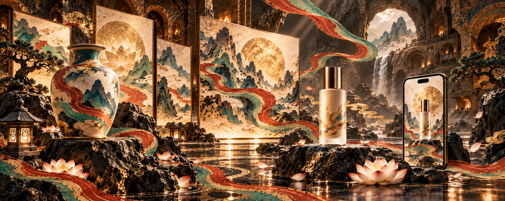

# Dunhuang Aura Skill

一个用于生成和修改“敦煌矿物美学商业视觉”的AI Skill，适合Codex、Claude Code及其他支持`SKILL.md`约定的智能体环境。

它不是一份简单的提示词合集。Skill会先判断交付物、比例、文字状态和构图模式，再约束色板、材质、光线、物体几何、敦煌元素密度及最终质检。

## 能做什么

- 5:2推特/X长文封面
- 无文字的全画幅商业主视觉
- 带精确标题的文章封面
- 敦煌风产品广告和电商主图
- AI图像工具、创意工作流主题封面
- 文化活动海报
- 手机和产品展示图
- 已有图片的去字、补满、平衡左右、降低装饰等局部修改
- 同一视觉系统下的多尺寸、多物料延展

## 视觉特征

- 炭黑洞窟和黑色岩石
- 沙色矿物壁画面板
- 朱砂、石绿、石青飘带
- 克制的赭石金光
- 陶瓷、玻璃、铜、石材的真实质感
- 前景产品、中景壁画、远景洞窟或山体的三层景深
- 敦煌元素服务商业主体，不使用宗教人物做装饰



## 安装

### Codex

```bash
git clone https://github.com/govin-ai/dunhuang-aura-skill.git ~/.codex/skills/dunhuang-aura
```

重启或重新打开Codex会话后调用：

```text
$dunhuang-aura 生成一张无文字的5:2商业封面，左右都要有明确主体，主题是AI图像生产。
```

### Claude Code

```bash
git clone https://github.com/govin-ai/dunhuang-aura-skill.git .claude/skills/dunhuang-aura
```

然后在任务中明确要求读取该Skill并生成或修改图片。

## 使用示例

```text
使用 $dunhuang-aura 生成5:2横版封面。不要文字和留白。左侧是一只大型矿物彩陶瓷瓶和三层发光画框，右侧是护肤品与手机展示，中间保留水面景深通道。
```

```text
使用 $dunhuang-aura 修改这张图：删除所有文字，保留产品、光线、色板和构图，把原来的标题区补成完整的洞窟画廊。
```

```text
使用 $dunhuang-aura 为一个茶品牌做一张5:2产品主视觉。茶罐必须保持原图形状，右侧产品占画面35%，左侧保留标题区，敦煌元素只使用飘带和藻井边框。
```

## 仓库结构

```text
dunhuang-aura/
├── SKILL.md
├── agents/
│   └── openai.yaml
├── assets/
│   └── example-5x2-text-free.png
├── references/
│   ├── prompt-recipes.md
│   ├── qa-checklist.md
│   ├── style-system.md
│   └── workflows.md
├── scripts/
│   └── check_prompt.py
├── tests/
│   ├── invalid-vague.txt
│   ├── test_check_prompt.py
│   └── valid-text-free.txt
├── LICENSE
└── README.md
```

## 提示词检查

```bash
python3 scripts/check_prompt.py your-prompt.txt --mode text-free --ratio 5:2
```

脚本会检查比例、文字禁用、敦煌色板、构图、材质、光线和常见AI套模板词。它只负责检查提示词完整度，不替代生成后的看图验收。

运行单元测试：

```bash
python3 -m unittest discover -s tests -v
```

## 设计边界

这个Skill默认排除佛像、菩萨、飞天、礼拜场景和直接复制的壁画人物。目标是提取敦煌的颜色、材质、空间与造型语法，用于现代商业视觉。

若任务本身是考古复原、历史场景或宗教内容，应先提供具体年代、洞窟、图像依据和准确性要求，不能直接套用商业模式。

## License

MIT
